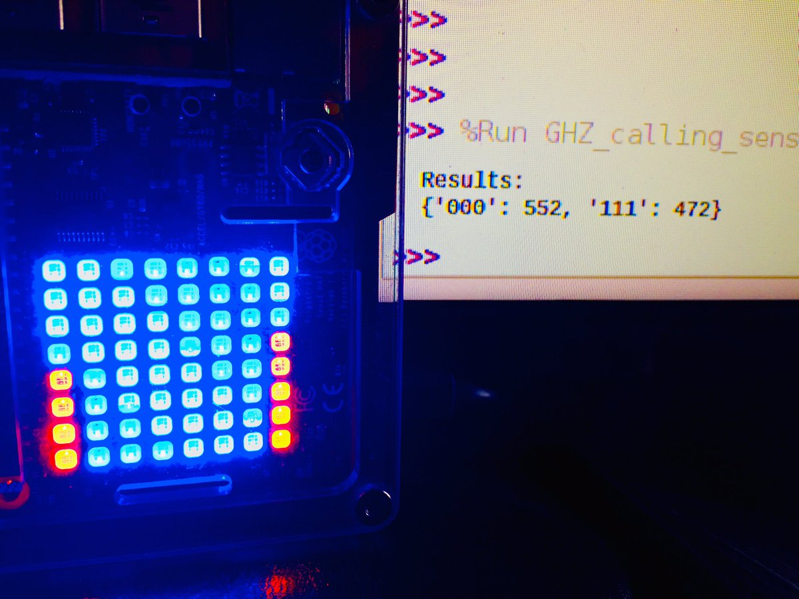
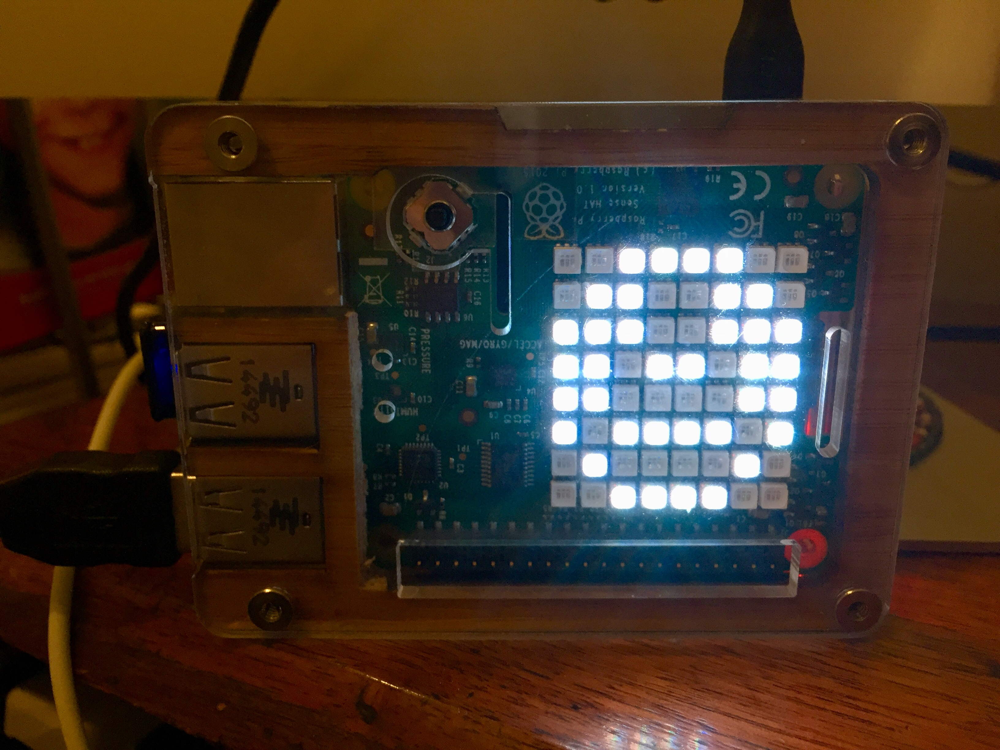
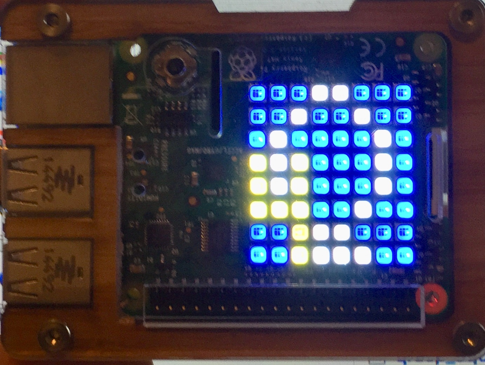

# Qrasp - Quantum Computing on Raspberry Pi SenseHat

A Python-based quantum computing interface that uses [Qiskit](https://qiskit.org) to run two and three qubit quantum circuits on IBM Q hardware or simulators, with real-time visualization on a Raspberry Pi SenseHat 8x8 LED display.



## 🎯 Overview

Qrasp makes quantum computing concepts tangible and interactive by providing:
- **Hands-on quantum experiments** with superposition and entanglement
- **Real-time visualization** of quantum measurement results
- **Joystick-controlled interface** for easy circuit selection
- **Dual backend support** - run on simulators or real IBM quantum hardware
- **Offline mode** - automatically falls back to local simulation when internet is unavailable

## 📋 Requirements

### Hardware
- Raspberry Pi 2B or newer (tested on a21041)
- Raspberry Pi Sense HAT v1.0 with:
  - 8x8 LED matrix display
  - 5-direction joystick
  - Accelerometer (for auto-rotation)

### Software
- Raspbian GNU/Linux 9 (stretch) or newer
- Python 3.x
- sense-hat 2.2.0+
- [Qiskit](https://qiskit.org/) v0.8+ / Qiskit Terra v0.7+
- IBM Q Experience account (optional, for hardware access)

## 🚀 Installation

1. **Install dependencies:**
   ```bash
   pip install qiskit sense-hat
   ```

2. **Configure IBM Q credentials (optional):**
   - Create a file named `Qconfig_IBMQ_experience.py`
   - Add your IBM Q API token:
     ```python
     APItoken = 'your_ibm_q_api_token_here'
     ```
   - Get your token from [IBM Quantum Experience](https://quantum-computing.ibm.com/)

3. **Run the application:**
   ```bash
   python main_controller.py
   ```

## 🎮 Usage

### Joystick Controls

| Direction | Action | Circuit Type |
|-----------|--------|--------------|
| **Up** | Bell State | 2-qubit entanglement |
| **Down** | GHZ State | 3-qubit entanglement |
| **Left** | 2-Qubit Superposition | Independent superposition |
| **Right** | 3-Qubit Superposition | Independent superposition |
| **Push** | Toggle Backend | Cycle through available backends |

### Backend Options

Press the joystick to cycle through:
1. **Aer Simulator** - Local quantum simulator (default, offline-capable)
2. **IBM Q Hardware** - Real quantum computers:
   - ibmqx2
   - ibmqx4
   - Least busy available backend

### Display Indicators


*Aer simulator mode indicator*


*IBM Q hardware mode with ibmqx4 selected*

### Result Visualization

The 8x8 LED matrix displays measurement results as bar graphs:
- **Red LEDs**: High probability outcomes
- **Blue LEDs**: Low probability outcomes
- **Color gradients**: Fine-grained probability visualization
- **Auto-rotation**: Display adjusts based on device orientation

## 🔬 Quantum Circuits

### 1. Two-Qubit Superposition (Left)
Creates independent superposition states using Hadamard gates:
```
                  ┌───┐┌─┐
q0_0: |0>────────┤ H ├┤M├
         ┌───┐┌─┐└───┘└╥┘
q0_1: |0>┤ H ├┤M├──────╫─
         └───┘└╥┘      ║
 c0_0: 0 ══════╬═══════╩═
               ║         
 c0_1: 0 ══════╩═════════
```

### 2. Three-Qubit Superposition (Right)
Creates three independent superposition states:
```
                         ┌───┐┌─┐
q1_0: |0>────────────────┤ H ├┤M├
                 ┌───┐┌─┐└───┘└╥┘
q1_1: |0>────────┤ H ├┤M├──────╫─
         ┌───┐┌─┐└───┘└╥┘      ║
q1_2: |0>┤ H ├┤M├──────╫───────╫─
         └───┘└╥┘      ║       ║
 c1_0: 0 ══════╬═══════╬═══════╩═
               ║       ║         
 c1_1: 0 ══════╬═══════╩═════════
               ║                 
 c1_2: 0 ══════╩═════════════════
```

### 3. Bell State (Up)
Demonstrates 2-qubit entanglement:
```
         ┌───┐        ┌─┐
q2_0: |0>┤ H ├──■─────┤M├
         └───┘┌─┴─┐┌─┐└╥┘
q2_1: |0>─────┤ X ├┤M├─╫─
              └───┘└╥┘ ║
 c2_0: 0 ═══════════╬══╩═
                    ║    
 c2_1: 0 ═══════════╩════
```

### 4. GHZ State (Down)
Demonstrates 3-qubit entanglement (Greenberger-Horne-Zeilinger state):
```
                                ┌───┐             ┌───┐┌─┐
q3_0: |0>───────────────────────┤ H ├──■──────────┤ H ├┤M├
              ┌───┐     ┌───┐┌─┐└───┘  │          └───┘└╥┘
q3_1: |0>─────┤ H ├──■──┤ H ├┤M├───────┼────────────────╫─
         ┌───┐└───┘┌─┴─┐└───┘└╥┘     ┌─┴─┐┌───┐┌─┐      ║
q3_2: |0>┤ X ├─────┤ X ├──────╫──────┤ X ├┤ H ├┤M├──────╫─
         └───┘     └───┘      ║      └───┘└───┘└╥┘      ║
 c3_0: 0 ═════════════════════╬═════════════════╬═══════╩═
                              ║                 ║         
 c3_1: 0 ═════════════════════╩═════════════════╬═════════
                                                ║         
 c3_2: 0 ═══════════════════════════════════════╩═════════
```

## 📁 Project Structure

```
qrasp/
├── main_controller.py              # Main application with offline detection
├── main_controller_wifi.py         # WiFi-required version
├── qc_sensehat_func.py            # LED display visualization logic
├── bell_calling_sense_func.py     # Bell state circuit implementation
├── GHZ_calling_sense_func.py      # GHZ state circuit implementation
├── q2_calling_sense_func.py       # 2-qubit superposition circuit
├── q3_calling_sense_func.py       # 3-qubit superposition circuit
├── README.md                       # This file
├── aer_logo.jpg                    # Aer simulator indicator image
├── ibmq_logo.jpg                   # IBM Q logo
├── ibmqx4_selected.jpg            # IBM Q hardware indicator image
└── qrasp_3qubit_GHZ.jpg           # Demo photo
```

## 🔄 Version History

### V0.6 (June 2019)
- ✨ **Offline mode**: Automatic fallback to Aer simulator when no internet connection
- 🔍 Internet connectivity detection

### V0.5 (May 2019)
- 🎯 **Best backend selection**: Automatically choose least busy IBM Q backend
- 📊 Display IBM Q version in backend selector

### V0.4 (April 2019)
- 🖥️ **More backends**: Added ibmqx2 and ibmqx4 support
- 🌈 **Color gradients**: Finer probability visualization with red-blue gradients
- 🎨 Enhanced display quality

### V0.3 (March 2019)
- ✅ Tested with Qiskit Terra 0.7
- 🔧 Removed v0.6/v0.7 compatibility workarounds

### V0.2 (March 2019)
- 🔬 **IBM Q hardware support**: Run circuits on real quantum computers
- 🔐 API token integration

### V0.1 (January 2019)
- 🎉 Initial release
- 💻 Qiskit v0.6.1 and Aer simulator support

## 🚧 Planned Features

- [ ] Animated "quantum calculations running" indicator during execution
- [ ] Queue status and position display for IBM Q hardware jobs
- [ ] SenseHat emulator support for development without hardware
- [ ] Additional quantum algorithms and circuits
- [ ] Custom circuit builder interface
- [ ] Result history and comparison features

## 📚 Learning Resources

- [IBM Q Experience Beginners Guide](https://quantum-computing.ibm.com/composer/docs/iqx/guide/)
- [Qiskit Documentation](https://qiskit.org/documentation/)
- [Quantum Computing Concepts](https://qiskit.org/textbook/preface.html)

## 🤝 Contributing

Contributions are welcome! Feel free to:
- Report bugs or issues
- Suggest new features or circuits
- Submit pull requests
- Share your quantum experiments

## 📄 License

This project is open source. Please check the repository for license details.

## 🙏 Acknowledgments

- IBM Qiskit team for the quantum computing framework
- Raspberry Pi Foundation for the hardware platform
- Quantum computing community for inspiration and support

---

**Made with ❤️ for quantum computing education**
